<p align="center">
  
</p>

# ModelGate

**合同感知的 AI 路由控制平面 / Contract-Aware AI Routing Control Plane**

[中文](#中文) · [English](#english)

---

## 中文

### 项目概述

ModelGate 是一个合同感知的 AI 路由控制平面：上传客户合同后，ReAct Agent 自动抽取合规、隐私、延迟与成本约束并生成客户画像；每个请求先由微调路由器分档，再在合同允许的模型中选择成本最优解，并完整记录路由与成本数据。

### 解决什么问题

企业同时面对几十个模型，却往往只选一个“全能模型”承载所有请求，导致：

- 简单请求被过度配置，成本与能耗浪费
- 复杂请求被弱模型处理，质量不稳定
- 合同里的区域、隐私、供应商限制靠人工记忆，容易违规

ModelGate 把合同变成可执行的运行时策略：客户只需把 `base_url` 换成 ModelGate，模型选择、合规校验和成本优化都由控制平面完成。

### 核心能力

| 能力 | 说明 |
|---|---|
| 合同抽取 Agent | ReAct 循环 + 6 个只读工具，多步查询目录与覆盖情况后产出客户画像 |
| 合规清洗 | 强制剔除目录外模型、被合同禁止的供应商，跨档兜底时补 `model_gap` 警告 |
| 三档路由 | `simple` / `medium` / `complex`，由微调分类器判定，支持 `modelgate-{tier}` 强制指定 |
| 合同约束执行 | 区域（CN/EU/US）、隐私等级、供应商白名单/黑名单、延迟与成本敏感度 |
| OpenAI 兼容代理 | `POST /{customer_id}/v1/chat/completions`，`model=auto` 自动路由 |
| 测试台 | 按合同展示路由决策，实际回复走 DeepSeek 直连，默认关闭思考模式 |
| 可观测性 | 每次抽取记录模式、轮次、token、成本、耗时、预算触发原因；每次请求记录路由轨迹与成本 |
| 预算与收敛 | 输入长度闸门、轮次/时间/token 预算、软预算提示、硬预算强制 finalize |
| 微调路由器 | Arch-Router-1.5B + GRPO，准确率 83.3%，Q8_0 GGUF 经 Ollama 提供约 62ms 分类 |

### 架构

```
┌──────────────────────────────┐
│  Next.js Dashboard  :3000    │  客户管理 / 模型注册 / 测试台 / 监控
└──────────────┬───────────────┘
               │ HTTP
┌──────────────▼───────────────┐
│  FastAPI Control Plane :8000 │
│  ├─ 合同抽取（ReAct Agent）   │──► DeepSeek 直连（关闭思考）
│  ├─ 路由引擎                  │──► Ollama: modelgate（Q8_0 GGUF）
│  ├─ OpenAI 兼容代理            │──► OpenRouter / ARK
│  ├─ 日志与统计                 │──► SQLite
│  └─ 测试台                     │──► DeepSeek 直连（按档位映射）
└──────────────────────────────┘
```

### 工作流程

```
合同（PDF / TXT / Markdown）
        │
        ▼
ReAct Agent：list_providers → check_coverage → list_models → check_profile → finalize
        │
        ▼
客户画像（区域 / 隐私 / 供应商 / 延迟 / 成本 / 三档偏好 / 警告）
        │
        ▼
请求进入 → 分类器分档 → 合同过滤 → 打分选型 → 代理调用 → 日志与统计
```

1. **上传合同**：支持 `.pdf`、`.txt`、`.md`，文本按 UTF-8 → GB18030 顺序解码
2. **抽取画像**：Agent 先查供应商和覆盖情况，再按“合规 > 隐私 > 质量 > 延迟 > 成本”选型
3. **统一校验**：Agent 与单次抽取的结果都经过同一套合规清洗与 warning 归一化
4. **路由请求**：分类器判定档位，路由引擎剔除违约模型并打分选择
5. **监控**：Dashboard 展示请求量、模型分布、成本、延迟和单请求路由轨迹

### 合同抽取 Agent

Agent 只做决策，事实全部来自工具，避免模型凭空编造模型目录：

| 工具 | 作用 |
|---|---|
| `list_providers` | 列出目录中的供应商及其区域/隐私能力 |
| `list_models` | 按档位、供应商、延迟、上下文、成本过滤模型 |
| `get_model` | 查询单个模型的价格、延迟、区域、上下文 |
| `check_coverage` | 检查合同约束下三档是否都有合规模型 |
| `check_profile` | 校验候选画像的冲突与违约项 |
| `finalize` | 提交最终画像，触发合规清洗 |

**Harness 预算**（均可在 `.env` 调整）：

| 参数 | 默认值 | 作用 |
|---|---|---|
| `MAX_CONTRACT_CHARS` | 200000 | 合同长度闸门，超限直接拒绝 |
| `AGENT_MAX_ITERS` | 14 | 轮次预算，达到后强制 finalize |
| `AGENT_MAX_TOKENS` | 80000 | 累计 token 硬预算 |
| `AGENT_SOFT_TOKEN_RATIO` | 0.7 | 软预算比例，提示模型收敛 |
| `AGENT_MAX_SECONDS` | 90 | 整轮 wall-clock 预算 |
| `AGENT_MAX_OUTPUT_TOKENS` | 2000 | 单次回复上限 |
| `AGENT_MAX_TOOL_CALLS_PER_ROUND` | 8 | 单轮工具调用上限 |

**超预算语义**：不是丢弃 Agent 的工作去重跑单次抽取，而是先追加提示让模型收敛；仍超限则用 `tool_choice` 强制调用 `finalize`，复用已收集的工具结果和推理。只有强制 finalize 本身失败，才回退到单次抽取。

**抽取观测**（写入 `CustomerProfile.extraction` 并输出日志）：

```json
{
  "mode": "react",
  "llm_calls": 5,
  "iterations": 5,
  "prompt_tokens": 19396,
  "completion_tokens": 1945,
  "total_tokens": 21341,
  "estimated_cost_usd": null,
  "elapsed_ms": 23317,
  "finalized_by": "model",
  "budget_hit": null
}
```

配置 `DEEPSEEK_INPUT_PRICE_PER_M` 与 `DEEPSEEK_OUTPUT_PRICE_PER_M` 后，`estimated_cost_usd` 自动计算；为 0 时不做成本估算。

### 路由规则

客户画像中的约束：

| 字段 | 取值 | 作用 |
|---|---|---|
| `region` | `any` / `CN-only` / `EU-only` / `US-only` | 只允许模型部署区域匹配 |
| `privacy_tier` | `low` / `standard` / `high` | 隐私等级 |
| `allowed_providers` | 供应商列表 | 白名单，空表示不限 |
| `forbidden_providers` | 供应商列表 | 黑名单 |
| `performance.latency_target_ms` | 毫秒 | 延迟目标 |
| `performance.cost_sensitivity` | `low` / `medium` / `high` | 成本权重 |

路由过程：分类 → 检查 `enabled` / 白名单 / 黑名单 / 区域 → 按目标打分（低延迟、低成本、高质量、合同目标）→ 无候选时向相邻档位升级 → 返回决策与淘汰原因。

### 技术栈

| 层 | 技术 |
|---|---|
| 后端 | Python 3.12、FastAPI、Pydantic、SQLite |
| 前端 | Next.js 16、React 19、TypeScript、Tailwind CSS、Recharts |
| 分类器 | Arch-Router-1.5B + GRPO LoRA，GGUF Q8_0，通过 Ollama 提供 |
| 合同抽取 | DeepSeek 直连（默认关闭思考模式），ReAct + 工具调用 |
| 正式代理 | OpenRouter 兼容接口（本部署指向字节 ARK） |
| 部署 | Docker 多阶段构建，单镜像同时运行前后端 |

### 目录结构

```
backend/
  main.py                     # FastAPI 入口
  config.py                   # 环境变量与预算参数
  models.py                   # Pydantic 数据模型
  database.py                 # SQLite 读写
  agent/
    contract_agent.py         # ReAct 循环、预算、强制 finalize
    tools.py                  # 6 个只读工具
    prompts.py                # System prompt 与工具 schema
  routers/
    extraction.py             # 合同抽取（JSON / 上传 / Agent）
    proxy.py                  # OpenAI 兼容代理
    customers.py              # 客户画像 CRUD
    models.py                 # 模型注册表
    logs.py                   # 请求日志与统计
    playground.py             # 测试台
  services/
    classifier.py             # Ollama 分类器 + 启发式兜底
    extractor.py              # 单次抽取 + JSON 修复重试
    profile_policy.py         # 合规清洗、warning 归一化、抽取指标
    router_engine.py          # 候选过滤、打分、跨档兜底
    provider_registry.py      # 默认模型目录与成本估算
  tests/
    test_contract_agent.py    # 工具、Agent 循环、预算、异常回灌
frontend/
  src/app/                    # 客户 / 模型 / 测试台页面
  src/lib/api.ts              # API 客户端
finetuning/                   # GRPO 训练、评测、GGUF 导出
scripts/                      # 种子数据、MMLU / 路由评测
customer_contracts/           # 10 份中英文示例合同
docs/                         # 改造清单、工程骨架、Agent 方案
ollama/Modelfile              # 将 GGUF 导入 Ollama
models/                       # 本地 GGUF（不提交仓库）
```

### 快速开始

#### 方式一：Docker

```bash
cp .env.example .env
# 填入 DEEPSEEK_API_KEY、OPENROUTER_API_KEY 等
docker compose up --build
```

访问：

- Dashboard: http://localhost:3000
- API: http://localhost:8000
- API Docs: http://localhost:8000/docs

#### 方式二：本地运行

```bash
# 后端（Linux / macOS）
python3.12 -m venv backend/venv
source backend/venv/bin/activate
pip install -r backend/requirements.txt
python scripts/seed_data.py
uvicorn backend.main:app --port 8000

# 前端（另开终端）
cd frontend
npm install
npm run dev
```

Windows PowerShell：

```powershell
python -m venv backend\venv
.\backend\venv\Scripts\Activate.ps1
pip install -r backend\requirements.txt
python scripts\seed_data.py
uvicorn backend.main:app --port 8000
```

#### 启用微调分类器（可选）

```bash
# 1. 将 ModelGate-Router.Q8_0.gguf 放到 models/
# 2. 导入 Ollama
ollama create modelgate -f ollama/Modelfile
# 3. 确认服务可用
curl http://localhost:11434/api/show -d '{"model":"modelgate"}'
```

Ollama 不可用时，分类器自动退回关键词启发式，系统仍可运行。

### 环境变量

| 变量 | 默认值 | 说明 |
|---|---|---|
| `DEEPSEEK_API_KEY` | 空 | 合同抽取与测试台的 DeepSeek Key |
| `DEEPSEEK_BASE_URL` | `https://api.deepseek.com/v1` | DeepSeek 接口地址 |
| `EXTRACTION_MODEL` | `deepseek-flash` | 单次抽取模型（V4.1 Flash） |
| `REACT_MODEL` | `deepseek-flash` | Agent 使用的模型 |
| `PLAYGROUND_MODEL_SIMPLE` | `deepseek-flash` | 测试台 simple 档 |
| `PLAYGROUND_MODEL_MEDIUM` | `deepseek-flash` | 测试台 medium 档 |
| `PLAYGROUND_MODEL_COMPLEX` | `deepseek-v4-pro` | 测试台 complex 档 |
| `DEEPSEEK_DISABLE_THINKING` | `true` | 所有 DeepSeek 调用关闭思考模式 |
| `OPENROUTER_API_KEY` | 空 | 正式代理的上游 Key |
| `OPENROUTER_BASE_URL` | `https://openrouter.ai/api/v1` | 上游接口地址 |
| `OLLAMA_BASE_URL` | `http://localhost:11434` | 分类器 Ollama 地址 |
| `OLLAMA_CLASSIFIER_MODEL` | `modelgate:latest` | 分类器模型名 |
| `MAX_CONTRACT_CHARS` | `200000` | 合同长度上限 |
| `AGENT_MAX_ITERS` / `AGENT_MAX_TOKENS` / `AGENT_MAX_SECONDS` | `14` / `80000` / `90` | Agent 硬预算 |
| `AGENT_SOFT_TOKEN_RATIO` | `0.7` | Agent 软预算比例 |
| `AGENT_MAX_OUTPUT_TOKENS` | `2000` | 单次回复上限 |
| `AGENT_MAX_TOOL_CALLS_PER_ROUND` | `8` | 单轮工具调用上限 |
| `DEEPSEEK_INPUT_PRICE_PER_M` / `DEEPSEEK_OUTPUT_PRICE_PER_M` | `0` | 抽取成本估算单价（美元/百万 token） |

> 只有合同抽取和测试台使用 DeepSeek；正式代理始终使用 `OPENROUTER_*` 配置，两者互不影响。

### API 一览

| 方法 | 路径 | 说明 |
|---|---|---|
| `GET` | `/health` | 健康检查与分类器状态 |
| `GET/POST` | `/customers` | 客户列表 / 创建 |
| `GET/PUT/DELETE` | `/customers/{id}` | 客户画像读取 / 更新 / 删除 |
| `POST` | `/extract` | 从 JSON 文本抽取画像 |
| `POST` | `/extract/upload` | 上传 PDF/TXT/MD 抽取画像 |
| `POST` | `/extract/react` | 显式 Agent 抽取（含回退） |
| `GET` | `/{id}/v1/models` | OpenAI 兼容模型列表 |
| `POST` | `/{id}/v1/chat/completions` | OpenAI 兼容路由代理 |
| `POST` | `/playground/chat?customer_id=...` | 测试台对话 |
| `GET` | `/logs`、`/logs/{id}` | 全局 / 客户请求日志 |
| `GET` | `/stats`、`/stats/{id}` | 全局 / 客户统计 |
| `GET/POST/PUT/DELETE` | `/models` | 模型注册表管理 |

代理响应头包含 `X-Model-Used`、`X-Classification`、`X-Latency-Ms`、`X-TTFT-Ms`、`X-Classify-Ms`、`X-Cost`、`X-Routing-Decision`。

### 测试

```bash
python -m unittest backend.tests.test_contract_agent -v
```

覆盖工具过滤、CN/EU 合规、Agent 全链路、幻觉模型剔除、工具参数错误回灌、未知工具、预算触发强制 finalize、不收敛保护。

### 微调路由器与评测

```bash
# GRPO 训练（RTX 3080 8GB，约 2.5 分钟）
python finetuning/grpo_run_nocot.py

# 导出 GGUF
python finetuning/export_gguf.py nocot

# 评测
python finetuning/bench_gguf.py
python scripts/bench_mmlu.py run --base-url http://localhost:8000/v1 --api-key dummy --model auto --label router
```

原始评测结果（60 道 MMLU，对比全部走 GPT-5.4）：

| | GPT-5.4 直连 | ModelGate 路由 | 变化 |
|---|---|---|---|
| 总体准确率 | 90% | 85% | -5pp |
| 难题准确率 | 80% | 80% | 0 |
| 成本 | $0.023 | $0.0095 | **-59%** |

GRPO 微调修正了原模型“86% 中等题被判为复杂”的盲区：

| 档位 | 原模型 | 微调后 | 变化 |
|---|---|---|---|
| Simple | 87.9% | 81.8% | -6.1pp |
| **Medium** | **14.3%** | **85.7%** | **+71.4pp** |
| Complex | 100% | 85.7% | -14.3pp |
| **总体** | **70.4%** | **83.3%** | **+13.0pp** |

- 训练：150 步、172 条标注 prompt、LoRA rank 32
- 推理：GGUF Q8_0（1.6 GB），约 62ms/次
- 评测：54 条与训练集无重叠的留出 prompt
- 模型下载：[ModelGate-Router on HuggingFace](https://huggingface.co/AaryanK/ModelGate)

### 部署注意

- `.env` 不提交仓库；容器通过 `env_file` 读取
- Docker 容器内的 `OLLAMA_BASE_URL` 不能写 `localhost`，Windows/macOS 用 `http://host.docker.internal:11434`
- `controlplane.db` 与合同原文不提交；Docker 使用 `modelgate-data` 卷持久化
- 测试台与合同抽取需要 DeepSeek Key；正式代理需要 OpenRouter/ARK Key

### 已知限制

- 分类器依赖 Ollama；未启动时退回启发式，分档精度下降
- PDF 仅支持文本型 PDF，扫描件需先 OCR
- 合同超过 20 万字符会被拒绝，需先分块
- 正式代理的模型目录以 `provider_registry.py` / 数据库注册表为准

### 致谢与许可

KSU Social Good Hackathon 2026 - Assurant Track 第三名。团队：Aaryan Kapoor（架构与 AI）、Pradyumna Kumar（平台与前端）、Danny Tran（设计与演示）。

MIT License，见 [LICENSE](LICENSE)。

---

## English

### Overview

ModelGate is a contract-aware AI routing control plane. Upload a customer contract and a ReAct agent extracts compliance, privacy, latency, and cost constraints into a structured profile. Every OpenAI-compatible request is classified by a fine-tuned router, then sent to the cheapest model that satisfies the contract, with full routing and cost observability.

### The Problem

Enterprises juggle dozens of models but usually send everything to one premium model. The result is 50–90% wasted spend on over-provisioned requests, unstable quality on hard tasks, and compliance rules that live only in contracts and human memory.

ModelGate turns contracts into runtime policy. Customers change one line — the `base_url` — and the control plane handles model selection, compliance enforcement, and cost optimization.

### Capabilities

| Capability | Description |
|---|---|
| Contract extraction agent | ReAct loop with six read-only tools; queries catalog and coverage before producing a profile |
| Compliance sanitization | Removes unknown and contract-forbidden models; adds `model_gap` warnings on cross-tier fallback |
| Three-tier routing | `simple` / `medium` / `complex`, classified by the fine-tuned router; `modelgate-{tier}` forces a tier |
| Contract enforcement | Region, privacy tier, provider allow/deny lists, latency target, cost sensitivity |
| OpenAI-compatible proxy | `POST /{customer_id}/v1/chat/completions` with `model=auto` |
| Playground | Shows the contract-based routing decision; replies come from DeepSeek with thinking disabled |
| Observability | Extraction mode, iterations, tokens, cost, latency, budget trigger; per-request routing trace |
| Budgets | Input gate, iteration/time/token budgets, soft nudge, forced finalize |
| Fine-tuned router | Arch-Router-1.5B + GRPO, 83.3% accuracy, Q8_0 GGUF served through Ollama at ~62ms |

### Architecture

```
Next.js Dashboard :3000  →  FastAPI :8000
                              ├─ Contract extraction (ReAct) → DeepSeek direct
                              ├─ Routing engine              → Ollama: modelgate
                              ├─ OpenAI-compatible proxy     → OpenRouter / ARK
                              ├─ Logs and stats              → SQLite
                              └─ Playground                  → DeepSeek direct
```

### Flow

1. **Upload** a contract (`.pdf`, `.txt`, `.md`; UTF-8 then GB18030 decoding)
2. **Extract** a profile through `list_providers → check_coverage → list_models → check_profile → finalize`
3. **Sanitize** every profile through the same compliance pass, whether it came from the agent or single-shot extraction
4. **Route** each request: classify tier, eliminate non-compliant models, score the rest, proxy upstream
5. **Monitor** requests, model mix, cost, latency, and per-request routing traces

### Contract Extraction Agent

The model only makes decisions; facts come from tools:

| Tool | Purpose |
|---|---|
| `list_providers` | List providers with region/privacy capabilities |
| `list_models` | Filter by tier, provider, latency, context, cost |
| `get_model` | Inspect one model's price, latency, regions, context |
| `check_coverage` | Check whether every tier has a compliant model |
| `check_profile` | Validate a candidate profile for conflicts |
| `finalize` | Submit the profile and trigger sanitization |

**Harness budgets** (configurable in `.env`):

| Variable | Default | Purpose |
|---|---|---|
| `MAX_CONTRACT_CHARS` | 200000 | Reject oversized contracts before any LLM call |
| `AGENT_MAX_ITERS` | 14 | Iteration budget |
| `AGENT_MAX_TOKENS` | 80000 | Cumulative token budget |
| `AGENT_SOFT_TOKEN_RATIO` | 0.7 | Soft budget ratio for the convergence nudge |
| `AGENT_MAX_SECONDS` | 90 | Wall-clock budget |
| `AGENT_MAX_OUTPUT_TOKENS` | 2000 | Per-response cap |
| `AGENT_MAX_TOOL_CALLS_PER_ROUND` | 8 | Per-round tool-call cap |

**Budget semantics**: hitting a budget does not discard the agent's work. The model gets a convergence nudge first; if the hard budget is reached, the harness forces a `finalize` call that reuses accumulated tool results and reasoning. Single-shot extraction is only a fallback when forced finalization itself fails.

**Extraction metrics** are stored on `CustomerProfile.extraction` and logged: mode, calls, iterations, prompt/completion/total tokens, estimated cost, elapsed time, `finalized_by`, and `budget_hit`.

### Routing Rules

Profile constraints: `region` (`any` / `CN-only` / `EU-only` / `US-only`), `privacy_tier`, `allowed_providers`, `forbidden_providers`, `latency_target_ms`, and `cost_sensitivity`.

Routing checks enabled models, provider allow/deny lists, and region; then scores by latency, cost, quality, and the customer's objective. If a tier has no valid candidate, the router escalates to the next tier and records eliminated candidates with reasons.

### Tech Stack

| Layer | Stack |
|---|---|
| Backend | Python 3.12, FastAPI, Pydantic, SQLite |
| Frontend | Next.js 16, React 19, TypeScript, Tailwind CSS, Recharts |
| Classifier | Arch-Router-1.5B + GRPO LoRA, GGUF Q8_0, served by Ollama |
| Extraction | DeepSeek direct, ReAct + tool calling, thinking disabled |
| Proxy upstream | OpenRouter-compatible API (this deployment uses ByteDance ARK) |
| Deployment | Multi-stage Docker image running both services |

### Project Structure

```
backend/
  main.py                     # FastAPI app
  config.py                   # Environment and budget settings
  models.py                   # Pydantic models
  database.py                 # SQLite access
  agent/
    contract_agent.py         # ReAct loop, budgets, forced finalize
    tools.py                  # Six read-only tools
    prompts.py                # System prompt and tool schema
  routers/
    extraction.py             # JSON / upload / agent extraction
    proxy.py                  # OpenAI-compatible proxy
    customers.py              # Profile CRUD
    models.py                 # Model registry
    logs.py                   # Request logs and stats
    playground.py             # Playground
  services/
    classifier.py             # Ollama classifier + heuristic fallback
    extractor.py              # Single-shot extraction + JSON repair
    profile_policy.py         # Sanitization, warning normalization, metrics
    router_engine.py          # Candidate filtering, scoring, escalation
    provider_registry.py      # Default catalog and cost estimation
  tests/
    test_contract_agent.py    # Tools, agent loop, budgets, error injection
frontend/
  src/app/                    # Customers / models / playground pages
  src/lib/api.ts              # API client
finetuning/                   # GRPO training, eval, GGUF export
scripts/                      # Seed data, MMLU / router benchmarks
customer_contracts/           # Ten Chinese/English sample contracts
docs/                         # Refactor plan, engineering skeleton, agent design
ollama/Modelfile              # Import the GGUF into Ollama
models/                       # Local GGUF files (not committed)
```

### Quick Start

#### Docker

```bash
cp .env.example .env
# Fill in DEEPSEEK_API_KEY, OPENROUTER_API_KEY, etc.
docker compose up --build
```

- Dashboard: http://localhost:3000
- API: http://localhost:8000
- API Docs: http://localhost:8000/docs

#### Local

```bash
python3.12 -m venv backend/venv
source backend/venv/bin/activate
pip install -r backend/requirements.txt
python scripts/seed_data.py
uvicorn backend.main:app --port 8000

# In a second terminal
cd frontend && npm install && npm run dev
```

#### Optional: enable the fine-tuned classifier

```bash
# Put ModelGate-Router.Q8_0.gguf into models/
ollama create modelgate -f ollama/Modelfile
curl http://localhost:11434/api/show -d '{"model":"modelgate"}'
```

If Ollama is unavailable, the classifier falls back to keyword heuristics and the system stays operational.

### Environment Variables

| Variable | Default | Description |
|---|---|---|
| `DEEPSEEK_API_KEY` | empty | Key for extraction and playground |
| `DEEPSEEK_BASE_URL` | `https://api.deepseek.com/v1` | DeepSeek endpoint |
| `EXTRACTION_MODEL` | `deepseek-flash` | Single-shot extraction model |
| `REACT_MODEL` | `deepseek-flash` | Agent model |
| `PLAYGROUND_MODEL_SIMPLE` / `MEDIUM` | `deepseek-flash` | Playground simple/medium reply model |
| `PLAYGROUND_MODEL_COMPLEX` | `deepseek-v4-pro` | Playground complex reply model |
| `DEEPSEEK_DISABLE_THINKING` | `true` | Disable thinking on all DeepSeek calls |
| `OPENROUTER_API_KEY` / `OPENROUTER_BASE_URL` | empty / `https://openrouter.ai/api/v1` | Proxy upstream |
| `OLLAMA_BASE_URL` / `OLLAMA_CLASSIFIER_MODEL` | `http://localhost:11434` / `modelgate:latest` | Classifier service |
| `MAX_CONTRACT_CHARS` | `200000` | Contract length gate |
| `AGENT_MAX_ITERS` / `AGENT_MAX_TOKENS` / `AGENT_MAX_SECONDS` | `14` / `80000` / `90` | Hard budgets |
| `AGENT_SOFT_TOKEN_RATIO` | `0.7` | Soft budget ratio |
| `AGENT_MAX_OUTPUT_TOKENS` | `2000` | Per-response cap |
| `AGENT_MAX_TOOL_CALLS_PER_ROUND` | `8` | Per-round tool-call cap |
| `DEEPSEEK_INPUT_PRICE_PER_M` / `DEEPSEEK_OUTPUT_PRICE_PER_M` | `0` | Cost estimation prices (USD per 1M tokens) |

> Only extraction and the playground use DeepSeek. The production proxy always uses `OPENROUTER_*`.

### API

| Method | Path | Purpose |
|---|---|---|
| `GET` | `/health` | Health and classifier status |
| `GET/POST` | `/customers` | List / create customers |
| `GET/PUT/DELETE` | `/customers/{id}` | Read / update / delete a profile |
| `POST` | `/extract` | Extract from JSON text |
| `POST` | `/extract/upload` | Extract from PDF/TXT/MD upload |
| `POST` | `/extract/react` | Explicit agent extraction (with fallback) |
| `GET` | `/{id}/v1/models` | OpenAI-compatible model list |
| `POST` | `/{id}/v1/chat/completions` | OpenAI-compatible routed proxy |
| `POST` | `/playground/chat?customer_id=...` | Playground chat |
| `GET` | `/logs`, `/logs/{id}` | Global / customer request logs |
| `GET` | `/stats`, `/stats/{id}` | Global / customer stats |
| `GET/POST/PUT/DELETE` | `/models` | Model registry |

Proxy responses expose `X-Model-Used`, `X-Classification`, `X-Latency-Ms`, `X-TTFT-Ms`, `X-Classify-Ms`, `X-Cost`, and `X-Routing-Decision`.

### Tests

```bash
python -m unittest backend.tests.test_contract_agent -v
```

Covers tool filtering, CN/EU compliance, full agent loops, hallucinated-model removal, malformed tool arguments, unknown tools, budget-triggered forced finalization, and non-convergence handling.

### Fine-Tuning and Benchmarks

```bash
python finetuning/grpo_run_nocot.py      # GRPO training
python finetuning/export_gguf.py nocot   # LoRA merge + GGUF export
python finetuning/bench_gguf.py          # Accuracy and latency
python scripts/bench_mmlu.py run --base-url http://localhost:8000/v1 --api-key dummy --model auto --label router
```

Original MMLU benchmark (60 questions, versus always routing to GPT-5.4):

| | GPT-5.4 Direct | ModelGate Router | Delta |
|---|---|---|---|
| Overall accuracy | 90% | 85% | -5pp |
| Hard accuracy | 80% | 80% | 0 |
| Cost | $0.023 | $0.0095 | **-59%** |

GRPO fixed the stock model's blind spot (86% of medium questions classified as complex):

| Tier | Stock | Fine-Tuned | Delta |
|---|---|---|---|
| Simple | 87.9% | 81.8% | -6.1pp |
| **Medium** | **14.3%** | **85.7%** | **+71.4pp** |
| Complex | 100% | 85.7% | -14.3pp |
| **Overall** | **70.4%** | **83.3%** | **+13.0pp** |

Training: 150 steps, 172 labeled prompts, LoRA rank 32. Inference: Q8_0 GGUF (1.6 GB), about 62ms per classification. Eval: 54 held-out prompts. Model: [ModelGate-Router on HuggingFace](https://huggingface.co/AaryanK/ModelGate).

### Deployment Notes

- `.env` is not committed; containers read it through `env_file`
- Inside Docker, set `OLLAMA_BASE_URL=http://host.docker.internal:11434` on Windows/macOS
- `controlplane.db` and raw contracts are not committed; the `modelgate-data` volume persists data
- DeepSeek keys are required for extraction and playground; OpenRouter/ARK keys are required for the proxy

### Known Limitations

- The classifier depends on Ollama; without it, heuristic routing lowers accuracy
- PDF support is text-based only; scanned documents need OCR first
- Contracts over 200k characters are rejected and must be chunked
- The proxied model catalog comes from `provider_registry.py` or the database registry

### Credits and License

3rd Place, KSU Social Good Hackathon 2026 — Assurant Track. Team: Aaryan Kapoor (Lead Architect & AI), Pradyumna Kumar (Platform & Frontend), Danny Tran (Design & Presentation).

MIT License — see [LICENSE](LICENSE).
